# -ES_52: láminas de construcción y comparación Q-V

Autor: Víctor Estrada Díaz  
Marco: UNIHOLOG - Máquina V  
Fecha: 10 de octubre de 2026

**Referencias del proyecto:**
[Documento base](./ES_52_Maquina_V_UNIHOLOG.pdf)
· [Traductores y compiladores de V](./Traductores_V/ES_52_Traductores_y_compiladores_de_V.pdf)
· [Presentación a la comunidad](./ES_52_Presentacion_comunidad.pdf)
· [Índice completo de recursos](./ES_52_Indice_recursos.pdf).

### Licencia Dual – Ética y Uso

- **Texto (CC BY-NC-SA 4.0)**: compartir y adaptar; uso no comercial,
  atribución a Víctor Estrada Díaz y compartir igual.
- **Código (HL3)**: uso comercial permitido solo si cumple principios éticos.
  Prohibidos: guerras, violación de los derechos humanos, daño ambiental,
  explotación, vigilancia masiva y discriminación.

**Principios éticos declarados por el autor**: respeto a la dignidad humana,
no uso lucrativo sin permiso y prohibición de usos dañinos.

Declaración: [estradad.es/licencia.php](https://estradad.es/licencia.php).
Más información: [CC BY-NC-SA 4.0](https://creativecommons.org/licenses/by-nc-sa/4.0/)
· [HL3](https://firstdonoharm.dev/version/3/0/).
ORCID: [0000-0001-9942-1021](https://orcid.org/0000-0001-9942-1021).

Este documento reúne las dieciséis láminas del proyecto. Su propósito es
describir las construcciones, preparar sus conexiones y estudiar qué ocurre
al ejecutarlas. La comparación de Q y V debe considerar el problema,
la preparación, las operaciones, los resultados y los tiempos de ejecución;
no exige que dos ejecuciones individuales produzcan la misma muestra.

En la interpretación propuesta por el autor, la incertidumbre cuántica
tiene su origen en una propiedad interna del espacio-tiempo: para fijar
qué conocemos y qué desconocemos debemos situarnos en un punto de la
línea temporal, $t=t_0$. La medida establece ese punto de referencia y
hace conocido el resultado que antes de ella permanecía desconocido.
El marco UNIHOLOG del autor explica esta relación mediante la función
$f(t)$, entendida como función interna del espacio-tiempo: desde la
referencia $t=t_0$ distingue lo definido para $t<t_0$ de lo aún indefinido
para $t>t_0$. Aquí, «indefinido» se refiere al conocimiento disponible,
no a la inexistencia física del pasado ni del futuro. En esta interpretación,
el tiempo no desaparece por vivirlo: situarse en $t=t_0$ fija la referencia
de conocimiento y medida, no elimina los demás puntos de la línea temporal.
Esta es la idea temporal que guía la construcción de V y su comparación
con Q; no identifica el desconocimiento con la inexistencia de un estado físico.

En V, `@` indica un resultado individual desconocido y no leído antes de
la medida. Las conexiones y las relaciones entre unidades pueden conocerse
sin leer sus resultados. Una preparación especificada, por ejemplo un
auxiliar inicializado en cero, no debe confundirse con una lectura intermedia.

La lectura final conjunta se efectúa en $t=t_0$. Cada resultado binario
registrado pertenece a $\{0,1\}$. `@` no es un tercer valor físico.
La descripción de una regla y la conexión ejecutable de esa regla son
etapas distintas de la construcción, que este documento identifica.

Las imágenes se incluyen desde el directorio relativo `./img/`, equivalente
a `.\img`. Las fórmulas utilizan exclusivamente delimitadores de dólar simple
para matemática en línea y doble para matemática en bloque. Este anexo no sustituye
el documento principal [ES_52_Maquina_V_UNIHOLOG.pdf](ES_52_Maquina_V_UNIHOLOG.pdf).

## 1. Paralelismo temporal de la medida

La fila superior representa Q; la inferior, la construcción propuesta de V.
En V no se consultan los valores internos durante la ejecución. El símbolo
$@$ representa el resultado aún desconocido, no la ausencia de un estado físico.
La medida en $t=t_0$ registra una salida binaria:

$$
M_Q(t_0)\in\{0,1\},\qquad M_V(t_0)\in\{0,1\}.
$$

El dibujo expresa el paralelismo temporal de preparación, operaciones sin
medidas intermedias y lectura final. No representa una respuesta calculada
previamente y ocultada. La coincidencia de resultados y distribuciones de
ambas realizaciones debe comprobarse por protocolo; no se deduce únicamente
del desconocimiento anterior a la medida.

## 2. Panorama Q1-V1

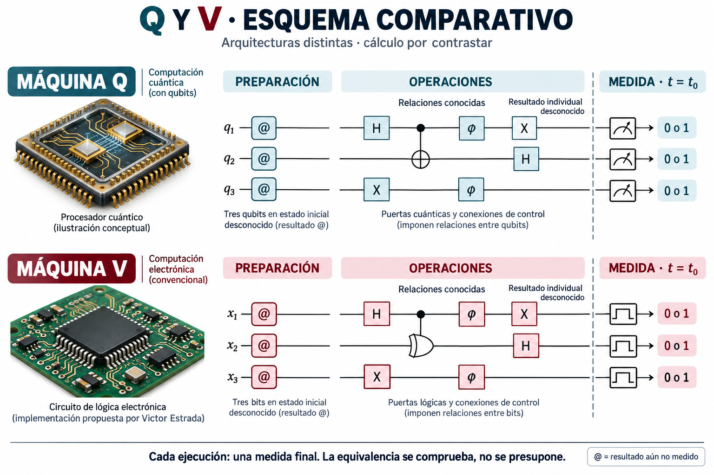

La lámina coloca Q arriba y V abajo. Alinea preparación, operaciones y
medida final para distinguir la arquitectura de la tarea realizada. Las
puertas pueden establecer relaciones sin revelar resultados individuales.
Es un panorama conceptual: el detalle del protocolo de Deutsch se desarrolla
en el documento principal, no queda especificado por todas las puertas
genéricas del dibujo.

En ese protocolo se utiliza el oráculo reversible

$$
(x,y)\longmapsto(x,y\oplus f(x)).
$$

El registro se prepara con $x=0$ e $y=1$; se aplica H a las dos unidades,
después el oráculo y finalmente H a la primera. En Q, la lectura ideal de
la primera unidad distingue las funciones constantes de las balanceadas.
La construcción de V1 debe enlazar estas operaciones con su lectura final.

## 3. Panorama Q2-V2

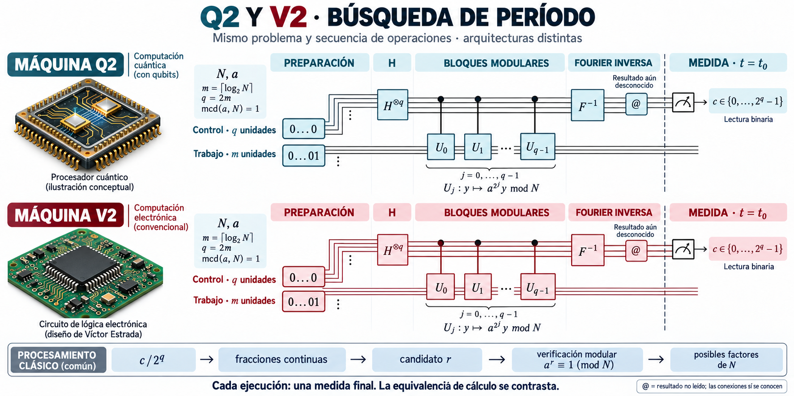

Q2 y V2 se organizan para estudiar el período de la función modular con
los mismos parámetros conocidos $N$ y $a$, donde $\gcd(a,N)=1$.
El registro de control recibe H, gobierna las multiplicaciones modulares
y pasa por Fourier inversa antes de la medida. El trabajo se prepara en
uno y el control en cero.

$$
m=\lceil\log_2 N\rceil,\qquad q=2m.
$$

La lectura binaria $c$ permite formar $c/2^q$ y proponer un período mediante
fracciones continuas. El candidato se verifica modularmente antes de obtener
posibles factores. Una sola lectura no garantiza que se obtengan factores.

## 4. Panorama Q3-V3

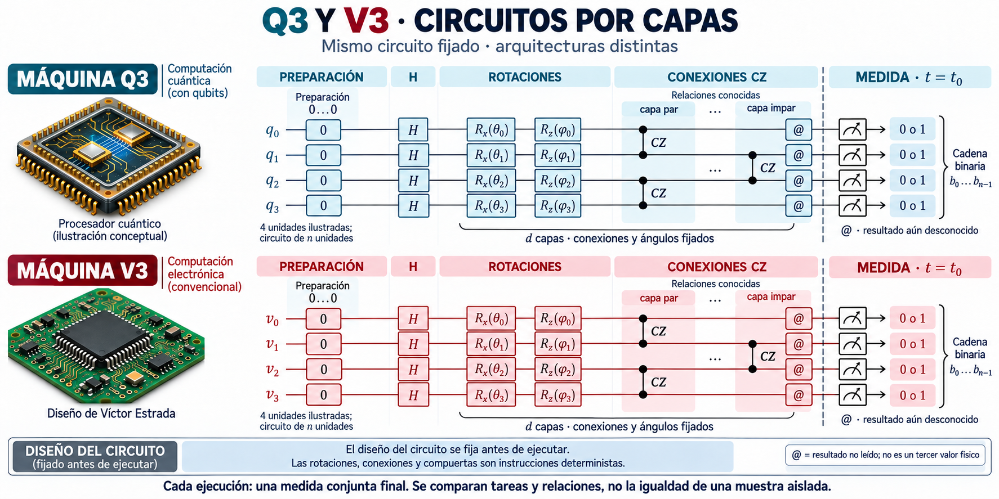

La lámina representa la familia local de circuitos por capas del proyecto.
La preparación, los ángulos y las conexiones se fijan antes de ejecutar.
Las capas combinan H, rotaciones y CZ, con alternancia de pares conectados.
El circuito ilustrado no se identifica con una instancia original de Willow.

La lectura final de un registro de $n$ unidades entrega una palabra binaria

$$
\mathbf b=(b_0,\ldots,b_{n-1}),\qquad b_j\in\{0,1\}.
$$

Se comparan las respuestas del mismo circuito preparado, no la igualdad
obligatoria de dos palabras obtenidas en ejecuciones diferentes.

## 5. Inversor X y NOT

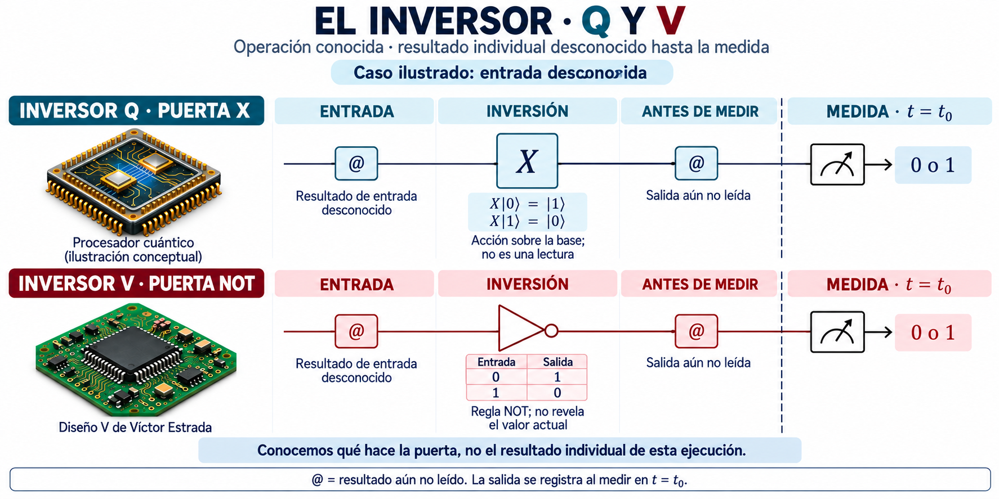

Con una entrada cuyo resultado es desconocido, la inversión está definida
sin leer ese resultado. X intercambia los dos vectores de la base; NOT
complementa el valor binario. Una entrada de base conocida puede permitir
predecir la salida: el desconocimiento es la condición del caso ilustrado,
no una propiedad universal de cualquier preparación.

$$
X|0\rangle=|1\rangle,\qquad X|1\rangle=|0\rangle,
\qquad b'=1-b.
$$

La construcción de V mantiene bloqueada la lectura individual hasta $t=t_0$.

## 6. Toffoli: tres entradas y tres salidas

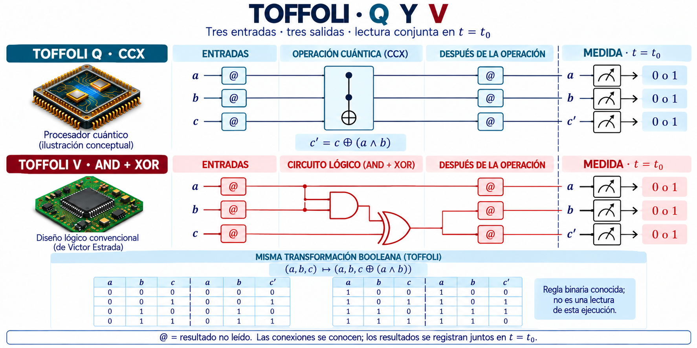

Toffoli conserva los dos controles y complementa el tercer valor solo
cuando ambos controles valen uno. No es una AND que elimina sus entradas.
La comparación conserva las tres entradas y las tres salidas:

$$
(a,b,c)\longmapsto(a,b,c'),\qquad c'=c\oplus(a\land b).
$$

En V, AND forma una señal intermedia y XOR la combina con $c$, sin leer
esa señal durante la operación. La tabla de la lámina expresa la regla
binaria, no observaciones de una ejecución en curso.

## 7. Construcción de Toffoli

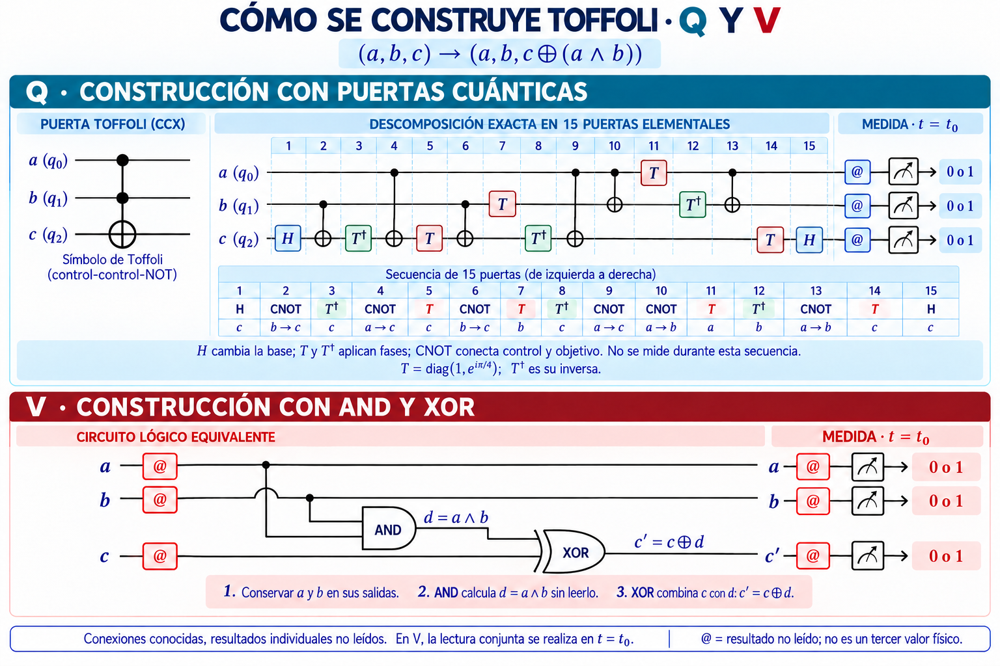

En Q, la lámina desarrolla una descomposición exacta de CCX con seis CNOT,
dos H y siete puertas de fase T o su inversa. Las etiquetas de las fases son

$$
T=\operatorname{diag}(1,e^{i\pi/4}),\qquad
T^\dagger=\operatorname{diag}(1,e^{-i\pi/4}).
$$

En V, los pasos de la construcción binaria son conservar $a,b$, formar
$d=a\land b$ y producir $c'=c\oplus d$. Las derivaciones de señales no deben
conectar directamente las líneas de entrada entre sí. El esquema de
lectura conserva las tres salidas hasta la medida conjunta.

## 8. Construcción de OR reversible

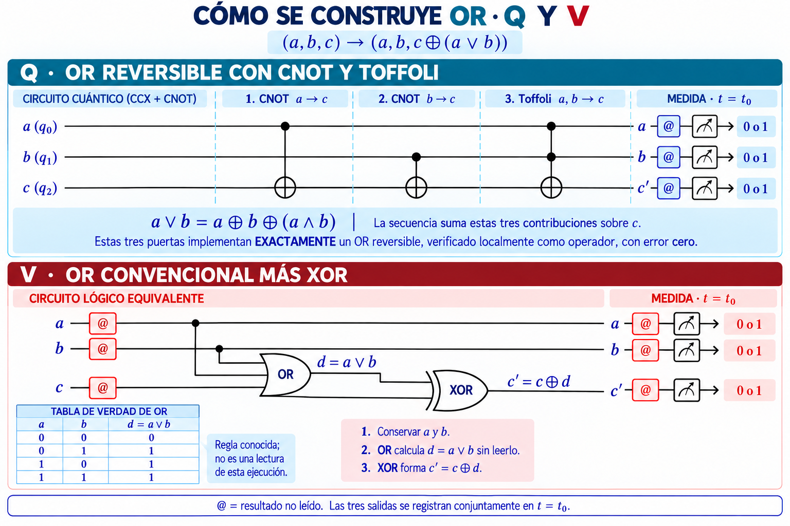

Para comparar las mismas entradas y salidas se inserta OR en una
transformación reversible de tres unidades:

$$
(a,b,c)\longmapsto(a,b,c\oplus(a\lor b)).
$$

En Q se aplican, en orden, CNOT de $a$ hacia $c$, CNOT de $b$ hacia $c$
y Toffoli con controles $a,b$ y objetivo $c$. La construcción se apoya en

$$
a\lor b=a\oplus b\oplus(a\land b).
$$

En V, OR produce $d=a\lor b$ y XOR combina $c$ con $d$, conservando $a,b$.
Las etiquetas de red repetidas indican las mismas señales, no generadores
adicionales ni lecturas intermedias.

## 9. CNOT y XOR controlada

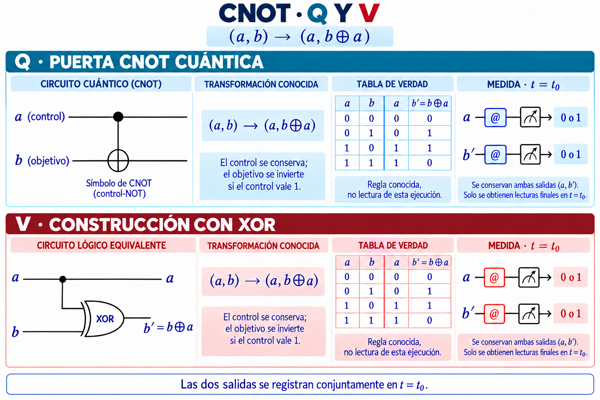

CNOT conserva el control y actualiza el objetivo. El circuito convencional
de V utiliza XOR con las mismas dos entradas y conserva la salida de control:

$$
(a,b)\longmapsto(a,b'),\qquad b'=b\oplus a.
$$

El resultado del objetivo no necesita leerse para conectar la operación.
La coincidencia de la tabla binaria describe esta función; la evolución
de fases de un registro general es otra parte del contraste de las máquinas.

## 10. Hadamard H

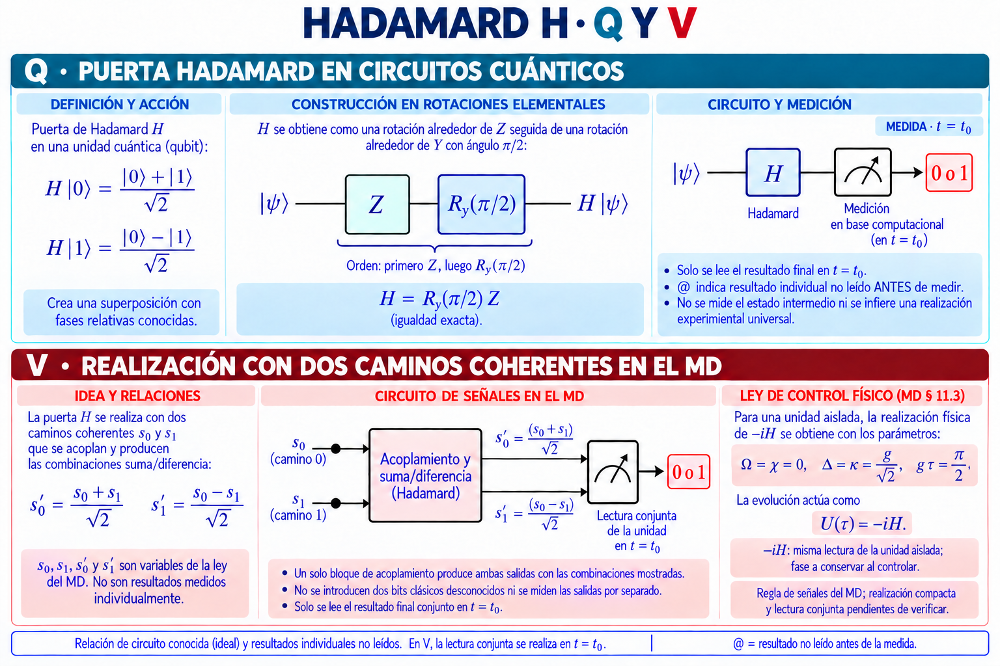

H combina los dos vectores de la base con suma y diferencia normalizadas:

$$
H|0\rangle=\frac{|0\rangle+|1\rangle}{\sqrt2},\qquad
H|1\rangle=\frac{|0\rangle-|1\rangle}{\sqrt2}.
$$

La construcción mediante rotaciones aplica Z primero y luego la rotación Y:

$$
H=R_y(\pi/2)Z.
$$

Para V se representan las leyes de dos caminos de señal del documento:

$$
s'_0=\frac{s_0+s_1}{\sqrt2},\qquad
s'_1=\frac{s_0-s_1}{\sqrt2}.
$$

Estos caminos pertenecen a una sola unidad, no a dos bits medidos.
En el bloque de acoplamiento del MD, los parámetros
$\Omega=\chi=0$, $\Delta=\kappa=g/\sqrt2$ y $g\tau=\pi/2$ producen
$-iH$. Esa fase global no altera la lectura de la unidad aislada, pero
debe conservarse al construir una operación controlada. La conexión
compacta de la ley de señales con la lectura de V sigue siendo una tarea
de construcción, no se sustituye por un sorteo.

## 11. Fase: T, inversa T, S, Z y fase general

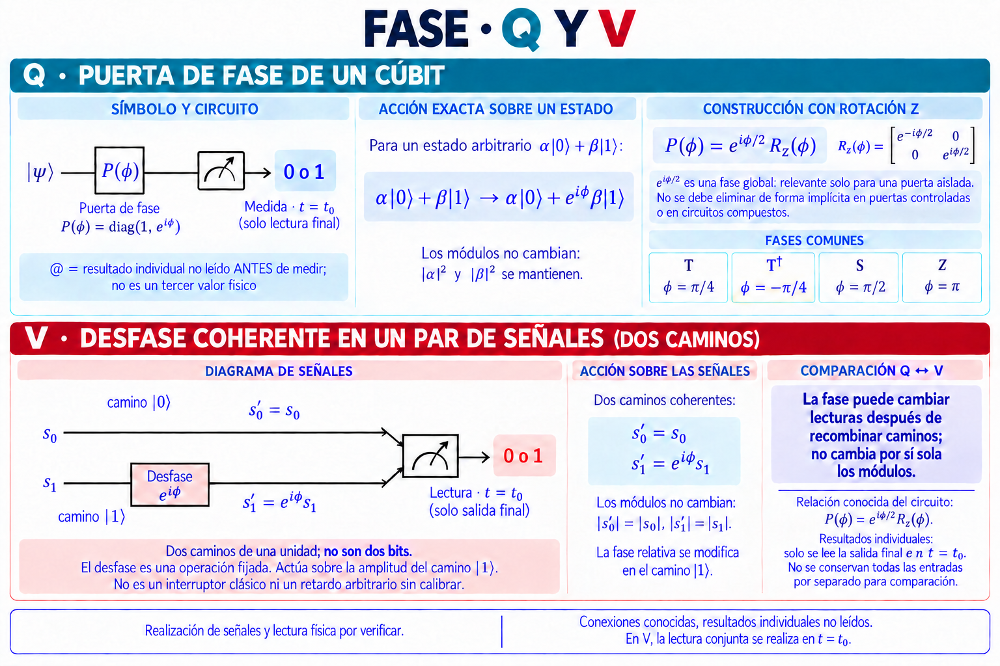

La puerta de fase actúa sin cambiar los módulos de los coeficientes:

$$
P(\varphi)=\operatorname{diag}(1,e^{i\varphi}),\qquad
P(\varphi)=e^{i\varphi/2}R_z(\varphi).
$$

Las elecciones $\varphi=\pi/4$, $-\pi/4$, $\pi/2$ y $\pi$ corresponden
respectivamente a T, su inversa, S y Z. Una fase relativa puede cambiar
lecturas posteriores cuando se combinan los caminos.

En la descripción de señales de V:

$$
s'_0=s_0,\qquad s'_1=e^{i\varphi}s_1.
$$

El desfase se fija como operación y no constituye una lectura del valor
individual. Una fase global de una unidad aislada no debe descartarse
automáticamente cuando esa operación pasa a estar controlada.

## 12. Rotaciones Rx y Rz

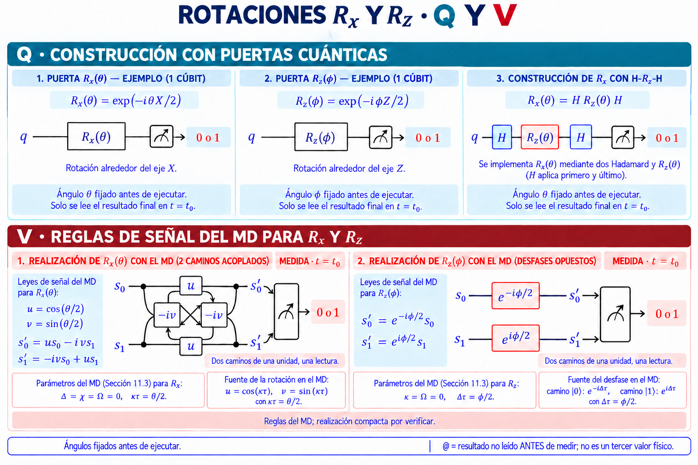

Las rotaciones y su composición cumplen

$$
R_x(\theta)=e^{-i\theta X/2},\qquad
R_z(\varphi)=e^{-i\varphi Z/2},\qquad
R_x(\theta)=H R_z(\theta)H.
$$

Con $u=\cos(\theta/2)$ y $v=\sin(\theta/2)$, las leyes de Rx sobre
los dos caminos de V son

$$
s'_0=u s_0-i v s_1,\qquad s'_1=-i v s_0+u s_1.
$$

Para Rz, las fases de los caminos tienen signos opuestos:

$$
s'_0=e^{-i\varphi/2}s_0,\qquad s'_1=e^{i\varphi/2}s_1.
$$

Los ángulos se conocen antes de ejecutar. Los caminos de cada ejemplo
alimentan una sola lectura de unidad, no medidas binarias separadas.

## 13. CZ y fase controlada

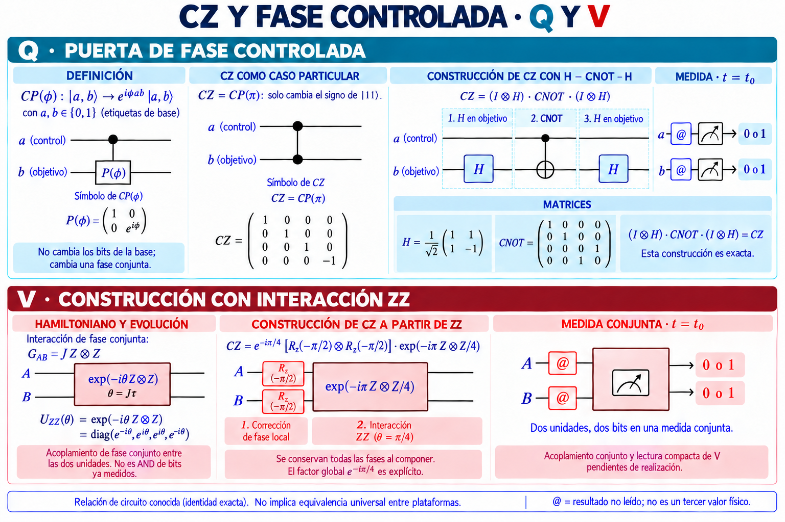

La fase controlada se define sobre los vectores de base mediante

$$
\operatorname{CP}(\varphi)|a,b\rangle
=e^{i\varphi ab}|a,b\rangle,\qquad
\operatorname{CZ}=\operatorname{CP}(\pi).
$$

CZ cambia el signo de la componente de base con ambas etiquetas iguales
a uno. En Q puede construirse con H sobre el objetivo, CNOT y H sobre
el objetivo otra vez. La interacción del MD utiliza

$$
G_{AB}=J Z\otimes Z,\qquad
U_{ZZ}(\theta)=e^{-i\theta Z\otimes Z},\qquad \theta=J\tau.
$$

La interacción ZZ sola no debe confundirse con CZ. La construcción incluye
las correcciones de fase locales y el factor global:

$$
\operatorname{CZ}=e^{-i\pi/4}
\left[R_z(-\pi/2)\otimes R_z(-\pi/2)\right]
e^{-i\pi Z\otimes Z/4}.
$$

En V se describe un acoplamiento conjunto, no una AND sobre bits ya leídos.
Las dos unidades entregan dos bits en una sola medida conjunta. La ley
conjunta debe enlazarse con la realización del circuito antes de medir.

## 14. SWAP

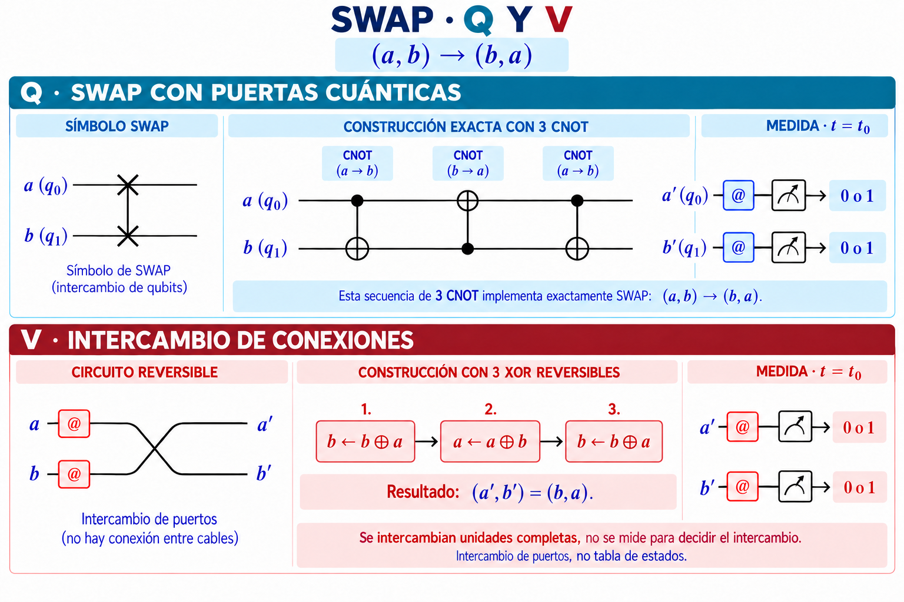

SWAP intercambia las dos unidades completas:

$$
(a,b)\longmapsto(b,a).
$$

En Q se construye con tres CNOT, dirigidas en orden de $a$ hacia $b$,
de $b$ hacia $a$ y de $a$ hacia $b$. En V puede conectarse un intercambio
de puertos o realizarse la secuencia de actualizaciones reversibles

$$
b\leftarrow b\oplus a,\qquad
a\leftarrow a\oplus b,\qquad
b\leftarrow b\oplus a.
$$

Las asignaciones se aplican de izquierda a derecha y usan el resultado
actualizado del paso anterior. No son instrucciones para medir y decidir
después qué cable intercambiar.

## 15. Multiplicación modular controlada

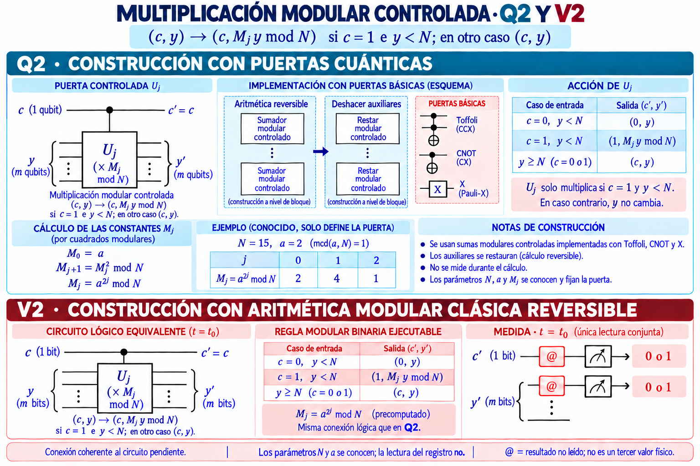

La puerta se configura con constantes conocidas; el período y los factores
no se suministran como respuestas:

$$
M_j=a^{2^j}\bmod N,\qquad
M_0=a,\qquad M_{j+1}=M_j^2\bmod N.
$$

Para un control $c$ y un registro de trabajo $y$, se conserva el control
y se define la acción sobre todo el dominio del registro:

$$
y'=\begin{cases}
M_j y\bmod N,&c=1\ \text{y}\ y<N,\\
y,&c=0\ \text{o}\ y\ge N.
\end{cases}
$$

La coprimalidad permite una permutación dentro del intervalo modular.
El esquema Q identifica aritmética reversible, sumas modulares controladas
y restauración de auxiliares; no es una lista exhaustiva de todas sus
puertas elementales. V dispone de la relación modular binaria, cuya conexión
coherente con H, las fases y la lectura del circuito completo debe construirse.

## 16. Fourier inversa

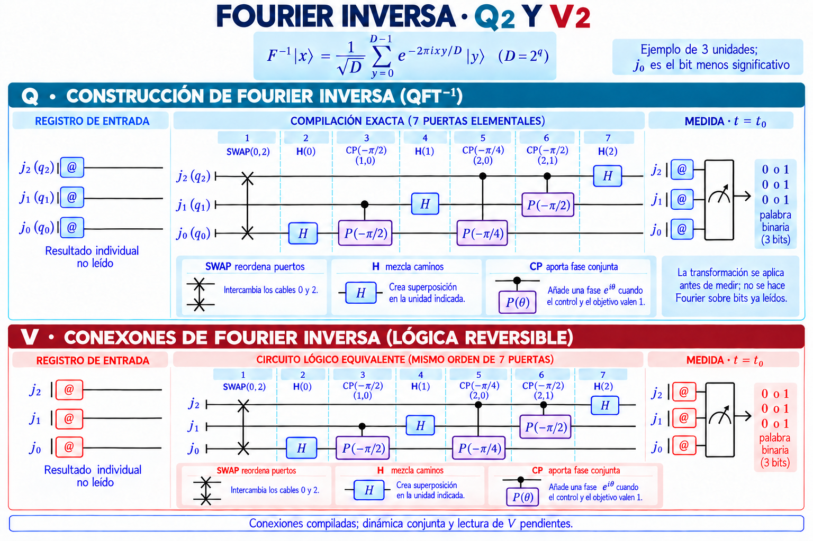

Para $q$ unidades y $D=2^q$, la transformación matemática es

$$
F^{-1}|x\rangle=\frac{1}{\sqrt D}
\sum_{y=0}^{D-1}e^{-2\pi ixy/D}|y\rangle.
$$

La suma define la transformación; no exige que V almacene una tabla de
estados o amplitudes. La lámina muestra el ejemplo de tres unidades,
con la unidad cero como bit menos significativo. El orden es:

1. SWAP entre las unidades cero y dos.
2. H sobre la unidad cero.
3. Fase controlada de ángulo $-\pi/2$ entre las unidades uno y cero.
4. H sobre la unidad uno.
5. Fase controlada de ángulo $-\pi/4$ entre las unidades dos y cero.
6. Fase controlada de ángulo $-\pi/2$ entre las unidades dos y uno.
7. H sobre la unidad dos.

Una fase controlada utiliza P, no Rz sin su corrección de fase.
En V se conserva esta secuencia de conexiones: H mezcla caminos,
CP aporta fase conjunta y SWAP reordena puertos. Su ejecución conjunta
se debe conectar a la lectura final; no se aplica Fourier a bits ya medidos.

