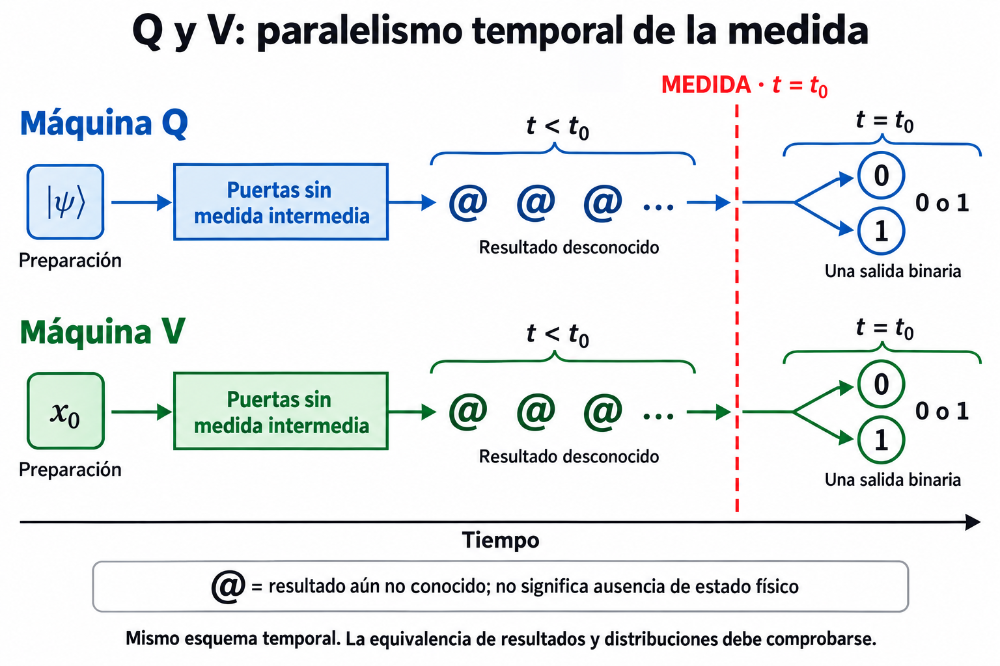

# -ES_52: Máquina V — principios cuánticos en circuitos convencionales

## Electrónica y programación desde Einstein-VED / UNIHOLOG

**Víctor Estrada Díaz · Einstein-VED — UNIHOLOG**  
11 de octubre de 2026 · [ORCID 0000-0001-9942-1021](https://orcid.org/0000-0001-9942-1021)

**Acceso al proyecto:** [dossier en DEMUESTRA](https://estradad.es/teorias/pdf/DEMUESTRA/proyectos/ES_52/) · [documento base](https://estradad.es/teorias/pdf/DEMUESTRA/proyectos/ES_52/ES_52_Maquina_V_UNIHOLOG.pdf) · [láminas](https://estradad.es/teorias/pdf/DEMUESTRA/proyectos/ES_52/ES_52_Laminas_Q_V.pdf) · [traductores y compiladores](https://estradad.es/teorias/pdf/DEMUESTRA/proyectos/ES_52/Traductores_V/ES_52_Traductores_y_compiladores_de_V.pdf) · [índice completo de recursos](https://estradad.es/teorias/pdf/DEMUESTRA/proyectos/ES_52/ES_52_Indice_recursos.pdf).

*Figura 1. La construcción V preserva el desconocimiento de los estados no fijados hasta la medida en t₀. La lámina expresa mediante @ el desconocimiento que el documento representa con ξ.*

### La aportación del trabajo

Este trabajo desarrolla una construcción para **utilizar los principios cuánticos en circuitos electrónicos convencionales y en programación**. La máquina V incorpora la medida y la dimensión temporal a su funcionamiento: los estados no fijados permanecen desconocidos hasta que se mide en $t=t_0$.

La aportación no se limita a comparar dos máquinas. Presento un criterio de construcción: **operar sobre relaciones sin conocer previamente los estados individuales y desencadenar su lectura mediante la medida**. Desde una máquina Q conocida, el proyecto desarrolla su correspondiente construcción V, sus puertas y sus programas, y establece cómo confrontar ambas mediante los mismos problemas y protocolos.

### Preservar el desconocimiento hasta la medida

La condición central de mi máquina V es que **no se conozcan los estados no fijados antes de medir en $t_0$**. No basta con ocultar una respuesta al lector mientras el programa ya la conoce: la construcción debe respetar ese desconocimiento previo, sin adelantar la lectura ni fijar de antemano los resultados que se van a medir.

En V, denomino **coherencia de la construcción** a la preservación de esta condición hasta la medida. El paralelismo que planteo con Q se apoya en mantener desconocidos los resultados no fijados durante las operaciones y obtenerlos al medir. Conocer una relación entre entradas y salidas no equivale a conocer sus valores individuales.

La arquitectura puede ser electrónica o programada; el requisito se mantiene: **si se introduce conocimiento anticipado de esos estados, se ha cambiado la máquina V que aquí se define**.

### Desconocer el valor no impide operar

En este trabajo, **ξ representa desconocimiento**, no un valor lógico adicional ni una palabra física que la máquina deba almacenar. Podemos desconocer los valores individuales y conocer, construir y transformar sus relaciones. Para un inversor:

$$
B=1-A,\qquad K(A)=\xi,\qquad K(B)=\xi.
$$

La relación queda definida aunque no hayamos leído A ni B. En la medida, realizada en un instante concreto, obtenemos un resultado registrado:

$$
t=t_0,\qquad M_V(t_0)=(v_0,\ldots,v_{n-1}),\qquad v_i\in\{0,1\}.
$$

El instante de medida no es una etiqueta añadida a una respuesta calculada previamente: **desencadena la lectura**. Una reconsulta devuelve esa misma lectura; no fabrica un nuevo intento. El controlador no debe introducir un registro exponencial de amplitudes ni recorrer posibles respuestas durante el disparo.

### La incertidumbre en Einstein-VED / UNIHOLOG

En mi marco **Einstein-VED / UNIHOLOG**, el indeterminismo y las probabilidades se explican desde el desconocimiento de los estados no fijados. Antes de la medida hablamos de posibilidades; al medir en $t=t_0$, el resultado de esa medida queda definido y registrado, y ya no es una posibilidad pendiente.

Esta interpretación vincula la incertidumbre a una **propiedad interna del espacio-tiempo**, expresada mediante $f(t)$, y al punto temporal desde el que podemos conocer los hechos. La posición en $t_0$ distingue lo conocido de lo que todavía no está fijado para esa lectura. Desconocer un estado no afirma su inexistencia; el pasado y el futuro tampoco desaparecen por nuestra posición en la línea temporal.

Esta es la idea que traslado a la construcción V: preservar el desconocimiento de los estados no fijados y hacer que la medida en $t_0$ produzca la lectura definida. La dimensión temporal y la medida forman parte de la máquina, tanto en electrónica convencional como en programación.

### De una máquina Q conocida a una construcción V

El proyecto reúne el documento base, las láminas Q1–V1, Q2–V2 y Q3–V3 y las construcciones de puertas. Añade una vía de trabajo: tomar un circuito descrito en **OpenQASM 2.0** y producir un plan V y controladores en **Python, Prolog y C++**.

El traductor conserva operaciones, controles, conexiones y orden. La interfaz separa preparación y disparo; requiere una realización conectada para obtener una lectura. El ejemplo incluido permite inspeccionar la traducción de H y CNOT; las instrucciones explican qué herramientas y qué realización necesita cada ejecución.

La guía, los lanzadores y los programas generados están enlazados en el [índice de recursos](https://estradad.es/teorias/pdf/DEMUESTRA/proyectos/ES_52/ES_52_Indice_recursos.pdf). La estructura relativa permite trasladar el conjunto del proyecto sin perder los enlaces entre sus documentos.

### Cómo propongo comparar Q y V

Q y V deben someterse al mismo protocolo observable: preparaciones, entradas, operaciones, configuraciones de medida, condiciones de funcionamiento e instantes de lectura. Si no se observan valores internos en Q durante el cálculo, tampoco deben exigirse esas lecturas a V como condición para compararlas.

Cada ejecución produce una lectura. Para estudiar distribuciones repetimos preparaciones independientes y registramos los resultados. La comparación mantiene el mismo acceso a la información en ambas máquinas.

El orden temporal se estudiará separando **preparación, evolución, disparo y lectura**, y declarando los recursos utilizados. Los informes y programas permiten documentar los tiempos correspondientes en ambas máquinas.

### Documentación, programas y comprobaciones

DEMUESTRA centraliza los documentos, los programas, los informes y su publicación. La [ficha del proyecto](https://estradad.es/teorias/pdf/DEMUESTRA/proyectos/ES_52/) permite recorrer las evaluaciones y acceder a sus datos. El [índice completo de recursos](https://estradad.es/teorias/pdf/DEMUESTRA/proyectos/ES_52/ES_52_Indice_recursos.pdf) enlaza cada material para que el lector pueda consultar directamente su contenido y sus resultados.

La invitación es concreta: **construir, ejecutar, registrar y contrastar**. Resultan especialmente útiles las realizaciones de las puertas y su lectura, los protocolos de interferencia y correlación, y las comparaciones de resultados, recursos y tiempos. Un acuerdo, una discrepancia o un límite experimental deben documentarse con el circuito, la preparación, la medida y los datos que permitan reproducirlos.

### Archivo con DOI y navegación del proyecto

El archivo general **Einstein-VED / UNIHOLOG** dispone de [DOI de versión 10.5281/zenodo.23284583](https://doi.org/10.5281/zenodo.23284583) y de [DOI de concepto 10.5281/zenodo.17172925](https://doi.org/10.5281/zenodo.17172925). El primero identifica una versión archivada; el segundo agrupa las versiones del registro. Estos DOI corresponden al archivo del marco general; el artículo y sus complementos se presentan en el proyecto 52 de DEMUESTRA.

Para leer y recorrer el material sin descargar el archivo completo, la entrada es el [proyecto 52 en DEMUESTRA](https://estradad.es/teorias/pdf/DEMUESTRA/proyectos/ES_52/). El [índice enlazado](https://estradad.es/teorias/pdf/DEMUESTRA/proyectos/ES_52/ES_52_Indice_recursos.pdf) reúne documentos, programas, láminas, informes y complementos; identifica aparte los ensayos históricos para no confundirlos con evaluaciones de la construcción actual.

### Licencia Dual — Ética y Uso

**Texto: CC BY-NC-SA 4.0.** Compartir y adaptar con atribución, sin uso comercial y compartiendo bajo la misma licencia.

**Código: HL3.** Uso comercial permitido únicamente si cumple los principios éticos aplicables. Prohibidos los usos bélicos, las violaciones de derechos humanos, el daño ambiental, la explotación, la vigilancia masiva y la discriminación.

**Principios éticos declarados por el autor:** respeto a la dignidad humana, no uso lucrativo sin permiso y prohibición de usos dañinos.
[Declaración del autor](https://estradad.es/licencia.php) · [CC BY-NC-SA 4.0](https://creativecommons.org/licenses/by-nc-sa/4.0/) · [HL3](https://firstdonoharm.dev/version/3/0/).
